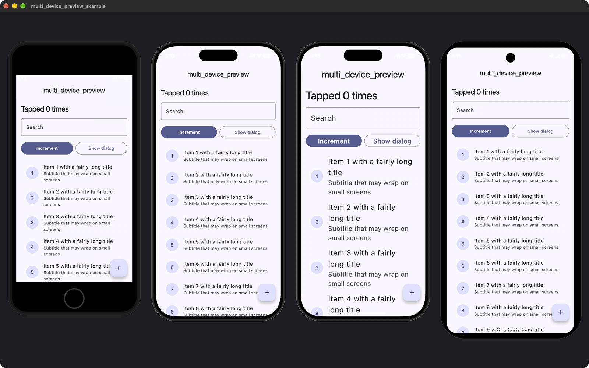

# multi_device_preview

> **Note:** multi_device_preview is an independent package by a different
> author. It uses the device frames and presets of
> [device_preview](https://pub.dev/packages/device_preview).

Run your Flutter app on **multiple device sizes and text scales side by side in
a single macOS window**, to catch overflows and broken layouts at a glance.



> Status: early development. Showing devices side by side works; mirroring
> input from one device to the others is in progress.

This is not a replacement for testing on real devices. Native UI, WebViews,
video and the software keyboard are out of scope.

## Usage

Add the package as a dev dependency and create a separate entry point outside
`lib/` so it never ends up in a release build:

```dart
// multi_device_preview/main.dart
import 'package:multi_device_preview/multi_device_preview.dart';

import 'package:my_app/app.dart';

void main() {
  runMultiDevicePreview(
    devices: const [
      PreviewDevice(preset: DevicePresets.iPhoneSe3),
      PreviewDevice(preset: DevicePresets.iPhone17),
      PreviewDevice(preset: DevicePresets.iPhone17, textScale: 1.5),
    ],
    // Called once per device: each device gets its own state.
    appBuilder: (context, slot) => const MyApp(),
  );
}
```

```sh
flutter run -d macos -t multi_device_preview/main.dart
```

Each device screen has the key `multi_device_preview.screen.<n>` (see
`DeviceSlot.screenKeyOf`), so tools such as Marionette can target a single
device.

### macOS entitlements

The preview runs as a macOS app. For a local development tool, disabling the
sandbox avoids extra setup for local servers and the Keychain. In
`macos/Runner/DebugProfile.entitlements`:

```xml
<key>com.apple.security.app-sandbox</key>
<false/>
<key>com.apple.security.cs.allow-jit</key>
<true/>
<key>com.apple.security.network.client</key>
<true/>
<key>com.apple.security.network.server</key>
<true/>
```

## Requirements for the app under preview

All devices run in one process, so:

- Avoid global `GlobalKey`s and singletons, or place them once above all
  devices.
- Persisted state (SharedPreferences, Keychain) is shared by all devices.
- Plugins without a macOS implementation throw `MissingPluginException`.
- Dialogs can use `rootNavigator` / `rootOverlay`: the tool creates no
  `Navigator` or `Overlay` above the devices, so they open inside the device.
- Every device is rendered as iOS in debug mode. Run the preview in debug
  mode; profile mode keeps the macOS look.

## License

MIT
